# دیاگرام‌های CRM املاک (Mermaid)

همه دیاگرام‌های پروژه در این پوشه به دو شکل در دسترس‌اند:

* فایل خام `*.mmd` — برای Mermaid Live Editor، ابزارها و CI
* همین صفحه — GitHub بلوک‌های `mermaid` را داخل Markdown به‌صورت تصویر رندر می‌کند

## ابزارها

| دستور | کار |
| --- | --- |
| `npm run diagrams` | بازتولید دیاگرام‌های داده‌محور + همین نمایه |
| `npm run diagrams:check` | بررسی هم‌خوانی دیاگرام‌های تولیدی با کد (بدون نوشتن) |
| `npm run diagrams:view` | مرورگر محلی دیاگرام‌ها با قابلیت بزرگ‌نمایی و خروجی SVG/PNG |
| `npm run flowchart` | فلوچارت کامل گردش‌کارها (نسخه flowchart، در `docs/superpowers/specs/`) |

دیاگرام‌های **تولیدی** از منبع حقیقت ساخته می‌شوند و نباید دستی ویرایش شوند:

| دیاگرام | منبع |
| --- | --- |
| `02-module-graph.mmd` | `import` های واقعی در `src/**` |
| `03-erd-overview.mmd` و `04-erd-full.mmd` | `migrations/0001_init.sql` |
| `07` تا `10` (گردش‌کارها) | `workflow-definitions/*.json` |
| `11-guards-effects-map.mmd` | `src/domain/guards` + `src/domain/effects` + تعریف‌ها |

---

## فهرست دیاگرام‌ها

1. [معماری کلی سامانه](#01-architecture) — دستی
2. [گراف وابستگی ماژول‌ها](#02-module-graph) — تولیدی
3. [نمودار موجودیت-رابطه (نمای کلی)](#03-erd-overview) — تولیدی
4. [نمودار موجودیت-رابطه (کامل)](#04-erd-full) — تولیدی
5. [چرخه عمر یک گذار](#05-transition-lifecycle) — دستی
6. [درون موتور گردش‌کار](#06-engine-plan) — دستی
7. [گردش‌کار قرارداد (contract v1)](#07-workflow-contract) — تولیدی
8. [گردش‌کار آگهی (listing v1)](#08-workflow-listing) — تولیدی
9. [گردش‌کار نیازمندی‌ها (requirements v1)](#09-workflow-requirements) — تولیدی
10. [گردش‌کار سایر خدمات (custom_service v1)](#10-workflow-custom-service) — تولیدی
11. [نگاشت گاردها و افکت‌ها](#11-guards-effects-map) — تولیدی
12. [سینک Push (اینگست)](#12-sync-push) — دستی
13. [سینک Pull و Webhook خروجی](#13-sync-pull-webhook) — دستی
14. [احراز هویت، نشست و RBAC](#14-auth-session) — دستی
15. [نقشه پنل و API](#15-panel-sitemap) — دستی
16. [استقرار با داکر](#16-deployment) — دستی

---

## 01-architecture

### معماری کلی سامانه

لایه‌ها (وب، سرویس، دامنه خالص، داده)، ورودی‌های بیرونی (کارمند، سرور اصلی، cron) و وابستگی بین آن‌ها.

* فایل: [`01-architecture.mmd`](./01-architecture.mmd) — نگهداری دستی

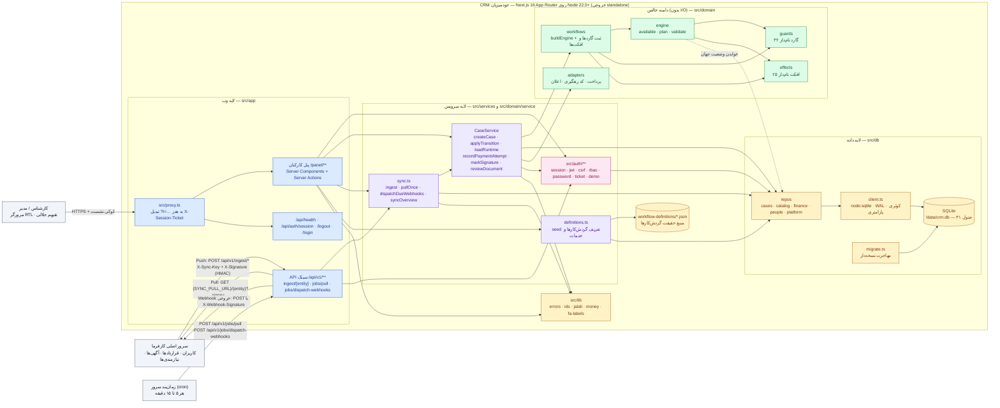

---

## 02-module-graph

### گراف وابستگی ماژول‌ها

یال‌ها از import های واقعی `@/…` در `src/**` استخراج می‌شوند؛ جهت وابستگی لایه‌ها را نشان می‌دهد.

* فایل: [`02-module-graph.mmd`](./02-module-graph.mmd) — تولید خودکار از کد (`npm run diagrams`)

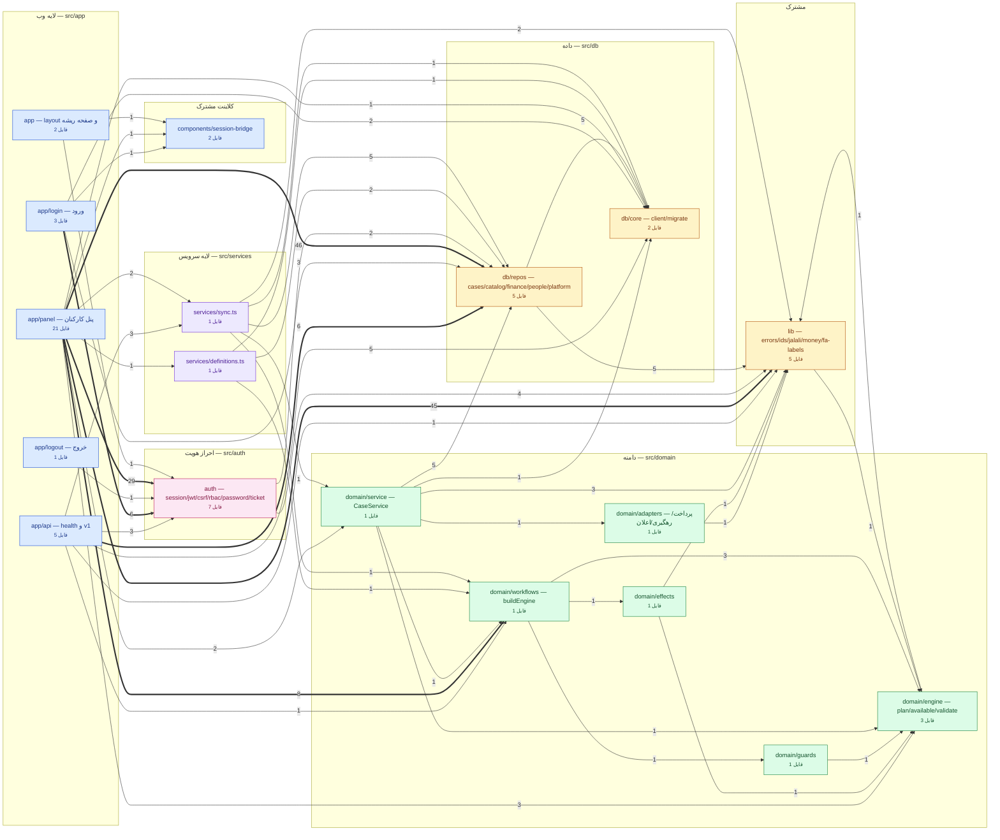

---

## 03-erd-overview

### نمودار موجودیت-رابطه (نمای کلی)

۳۱ جدول دیتابیس و رابطه‌های آن‌ها بدون جزئیات ستون‌ها — برای دیدن شکل کلی داده.

* فایل: [`03-erd-overview.mmd`](./03-erd-overview.mmd) — تولید خودکار از کد (`npm run diagrams`)

```mermaid
erDiagram
  STAFF ||--o{ SESSIONS : "کارمند"
  CASES ||--o{ CASE_TRANSITIONS : "پرونده"
  CASES ||--o{ TIMELINE_EVENTS : "پرونده"
  CASES |o--o{ TASKS : "پرونده"
  CASES ||--o{ DOCUMENTS : "پرونده"
  CASES ||--|| CONTRACT_DETAILS : "پرونده"
  CASES ||--o{ LEGAL_REVIEWS : "پرونده"
  CASES ||--o{ SIGNATURES : "پرونده"
  CASES ||--|| TRACKING_REQUESTS : "پرونده"
  CASES ||--o{ INVOICES : "پرونده"
  CASES ||--o{ PAYMENTS : "پرونده"
  INVOICES |o--o{ PAYMENTS : "فاکتور"
  REFERRAL_CODES ||--o{ REFERRAL_USES : "کد ریفرال"
  CASES ||--o{ REFERRAL_USES : "پرونده"
  CASES |o--o{ LISTINGS : "پرونده"
  CASES |o--o{ REQUIREMENTS : "پرونده"
  REQUIREMENTS ||--o{ REQUIREMENT_MATCHES : "نیازمندی"
  SYNC_LOG |o--o{ SYNC_ITEM_RESULTS : "لاگ سینک"
  SERVICES ||--o{ CASES : "خدمت (service_key) — منطقی"
  WORKFLOW_DEFINITIONS ||--o{ CASES : "گردش‌کار (workflow_key) — منطقی"
  USERS |o--o{ CASES : "مالک پرونده — منطقی"
  USERS |o--o{ CASES : "کارگزار — منطقی"
  STAFF |o--o{ CASES : "کارشناس مسئول — منطقی"
  STAFF |o--o{ TASKS : "انجام‌دهنده وظیفه — منطقی"
  STAFF |o--o{ TASKS : "سازنده وظیفه — منطقی"
  STAFF |o--o{ DOCUMENTS : "بررسی‌کننده مدرک — منطقی"
  STAFF |o--o{ LEGAL_REVIEWS : "بررسی‌کننده حقوقی — منطقی"
  STAFF |o--o{ TIMELINE_EVENTS : "کنشگر رویداد — منطقی"
  USERS |o--o{ SUBSCRIPTIONS : "اشتراک کاربر — منطقی"
  USERS |o--o{ REFERRAL_CODES : "صاحب کد — منطقی"
  STAFF |o--o{ REFERRAL_USES : "تأییدکننده مصرف — منطقی"
  USERS |o--o{ LISTINGS : "مالک آگهی — منطقی"
  USERS |o--o{ LISTINGS : "کارگزار آگهی — منطقی"
  USERS |o--o{ REQUIREMENTS : "درخواست‌کننده نیازمندی — منطقی"
  LISTINGS ||--o{ REQUIREMENT_MATCHES : "آگهی تطبیق‌شده — منطقی"
  USERS |o--o{ NOTIFICATIONS : "گیرنده پیام — منطقی"
  CASES |o--o{ NOTIFICATIONS : "پرونده مرتبط — منطقی"
  CASES |o--o{ OUTBOUND_WEBHOOKS : "پرونده مرتبط — منطقی"
```

---

## 04-erd-full

### نمودار موجودیت-رابطه (کامل)

همه ستون‌ها با نوع و نشانگر PK/FK/UK به‌همراه رابطه‌های صریح (REFERENCES) و منطقی (بدون FK).

* فایل: [`04-erd-full.mmd`](./04-erd-full.mmd) — تولید خودکار از کد (`npm run diagrams`)

```mermaid
erDiagram
  STAFF ||--o{ SESSIONS : "کارمند"
  CASES ||--o{ CASE_TRANSITIONS : "پرونده"
  CASES ||--o{ TIMELINE_EVENTS : "پرونده"
  CASES |o--o{ TASKS : "پرونده"
  CASES ||--o{ DOCUMENTS : "پرونده"
  CASES ||--|| CONTRACT_DETAILS : "پرونده"
  CASES ||--o{ LEGAL_REVIEWS : "پرونده"
  CASES ||--o{ SIGNATURES : "پرونده"
  CASES ||--|| TRACKING_REQUESTS : "پرونده"
  CASES ||--o{ INVOICES : "پرونده"
  CASES ||--o{ PAYMENTS : "پرونده"
  INVOICES |o--o{ PAYMENTS : "فاکتور"
  REFERRAL_CODES ||--o{ REFERRAL_USES : "کد ریفرال"
  CASES ||--o{ REFERRAL_USES : "پرونده"
  CASES |o--o{ LISTINGS : "پرونده"
  CASES |o--o{ REQUIREMENTS : "پرونده"
  REQUIREMENTS ||--o{ REQUIREMENT_MATCHES : "نیازمندی"
  SYNC_LOG |o--o{ SYNC_ITEM_RESULTS : "لاگ سینک"
  SERVICES ||--o{ CASES : "خدمت (service_key) — منطقی"
  WORKFLOW_DEFINITIONS ||--o{ CASES : "گردش‌کار (workflow_key) — منطقی"
  USERS |o--o{ CASES : "مالک پرونده — منطقی"
  USERS |o--o{ CASES : "کارگزار — منطقی"
  STAFF |o--o{ CASES : "کارشناس مسئول — منطقی"
  STAFF |o--o{ TASKS : "انجام‌دهنده وظیفه — منطقی"
  STAFF |o--o{ TASKS : "سازنده وظیفه — منطقی"
  STAFF |o--o{ DOCUMENTS : "بررسی‌کننده مدرک — منطقی"
  STAFF |o--o{ LEGAL_REVIEWS : "بررسی‌کننده حقوقی — منطقی"
  STAFF |o--o{ TIMELINE_EVENTS : "کنشگر رویداد — منطقی"
  USERS |o--o{ SUBSCRIPTIONS : "اشتراک کاربر — منطقی"
  USERS |o--o{ REFERRAL_CODES : "صاحب کد — منطقی"
  STAFF |o--o{ REFERRAL_USES : "تأییدکننده مصرف — منطقی"
  USERS |o--o{ LISTINGS : "مالک آگهی — منطقی"
  USERS |o--o{ LISTINGS : "کارگزار آگهی — منطقی"
  USERS |o--o{ REQUIREMENTS : "درخواست‌کننده نیازمندی — منطقی"
  LISTINGS ||--o{ REQUIREMENT_MATCHES : "آگهی تطبیق‌شده — منطقی"
  USERS |o--o{ NOTIFICATIONS : "گیرنده پیام — منطقی"
  CASES |o--o{ NOTIFICATIONS : "پرونده مرتبط — منطقی"
  CASES |o--o{ OUTBOUND_WEBHOOKS : "پرونده مرتبط — منطقی"

  SCHEMA_MIGRATIONS {
    text version PK "نسخه"
    text applied_at
  }
  SETTINGS {
    text key PK "کلید"
    text value
    text updated_at "زمان به‌روزرسانی"
  }
  STAFF {
    text id PK "شناسه یکتا"
    text username UK "نام کاربری"
    text password_hash "هش رمز (scrypt)"
    text full_name "نام کامل"
    text role "نقش"
    integer active "فعال است"
    text sso_subject UK
    text last_login_at
    text created_at "زمان ایجاد"
    text updated_at "زمان به‌روزرسانی"
  }
  SESSIONS {
    text id PK "شناسه یکتا"
    text staff_id FK "کارمند"
    text token_hash UK "هش توکن نشست"
    text user_agent
    text ip
    text created_at "زمان ایجاد"
    text expires_at "انقضا"
    text revoked_at "زمان ابطال"
  }
  USERS {
    text id PK "شناسه یکتا"
    text external_id "شناسه در سرور اصلی"
    text source "منبع داده"
    text full_name "نام کامل"
    text national_id
    text mobile "موبایل"
    text email "رایانامه"
    text user_type
    text agent_license_no
    text city "شهر"
    text status "وضعیت"
    integer deleted "حذف‌شده"
    text payload_hash
    text raw
    text synced_at
    text created_at "زمان ایجاد"
    text updated_at "زمان به‌روزرسانی"
  }
  SERVICES {
    text id PK "شناسه یکتا"
    text key UK "کلید"
    text name "نام"
    text category
    text description
    integer price "قیمت"
    integer requires_subscription
    integer requires_referral
    text workflow_key "کلید گردش‌کار"
    text required_documents
    integer active "فعال است"
    integer sort_order
    text created_at "زمان ایجاد"
    text updated_at "زمان به‌روزرسانی"
  }
  CASES {
    text id PK "شناسه یکتا"
    text code UK "کد"
    text external_id "شناسه در سرور اصلی"
    text source "منبع داده"
    text title "عنوان"
    text service_key "کلید خدمت"
    text workflow_key "کلید گردش‌کار"
    integer workflow_version "نسخه قفل‌شده گردش‌کار"
    text state "حالت گردش‌کار"
    text status "وضعیت"
    text outcome "نتیجه پرونده"
    text priority "اولویت"
    text owner_user_id
    text agent_user_id
    text assigned_staff_id
    text due_at "سررسید"
    integer requires_tracking "نیاز به کد رهگیری"
    text access_level "سطح دسترسی"
    text queue "صف کاری"
    integer attempts_payment "تلاش‌های پرداخت"
    integer attempts_tracking "تلاش‌های کد رهگیری"
    text meta
    text opened_at
    text closed_at
    text last_transition_at
    text created_at "زمان ایجاد"
    text updated_at "زمان به‌روزرسانی"
  }
  CASE_TRANSITIONS {
    text id PK "شناسه یکتا"
    text case_id FK "پرونده"
    text from_state
    text to_state
    text transition_key
    text transition_name
    text option
    text actor_type
    text actor_id
    text actor_name
    text reason
    text payload "بار JSON"
    text idempotency_key UK "کلید یکتاسازی"
    text at "زمان رویداد"
  }
  TIMELINE_EVENTS {
    text id PK "شناسه یکتا"
    text case_id FK "پرونده"
    text kind
    text title "عنوان"
    text body
    text visibility
    text actor_id
    text actor_name
    text at "زمان رویداد"
    text meta
  }
  TASKS {
    text id PK "شناسه یکتا"
    text case_id FK "پرونده"
    text title "عنوان"
    text description
    text priority "اولویت"
    text assignee_id
    text due_at "سررسید"
    text status "وضعیت"
    text result_note
    text created_by
    text dedupe_key UK
    text created_at "زمان ایجاد"
    text updated_at "زمان به‌روزرسانی"
    text completed_at
  }
  DOCUMENTS {
    text id PK "شناسه یکتا"
    text case_id FK "پرونده"
    text kind
    text title "عنوان"
    text status "وضعیت"
    text note "یادداشت"
    text review_note
    text reviewed_by
    text reviewed_at
    text file_name
    integer version "نسخه"
    text created_at "زمان ایجاد"
    text updated_at "زمان به‌روزرسانی"
  }
  CONTRACT_DETAILS {
    text id PK "شناسه یکتا"
    text case_id FK, UK "پرونده"
    text contract_type "نوع قرارداد (rent/sale)"
    text output_mode "خروجی موردنیاز"
    text property_address
    text city "شهر"
    text district "محله"
    real area "متراژ"
    text landlord_name
    text tenant_name
    text seller_name
    text buyer_name
    integer deposit_amount
    integer rent_amount
    integer sale_price
    text start_date
    text end_date
    text terms_note
    integer clause_version "نسخه بندها"
    text document_generated_at
    text created_at "زمان ایجاد"
    text updated_at "زمان به‌روزرسانی"
  }
  LEGAL_REVIEWS {
    text id PK "شناسه یکتا"
    text case_id FK "پرونده"
    text reviewer_id
    text result
    text note "یادداشت"
    integer clause_version_at_review
    text at "زمان رویداد"
  }
  SIGNATURES {
    text id PK "شناسه یکتا"
    text case_id FK "پرونده"
    text party
    text party_name
    text status "وضعیت"
    text method "روش"
    text signed_at
    text note "یادداشت"
    text created_at "زمان ایجاد"
  }
  TRACKING_REQUESTS {
    text id PK "شناسه یکتا"
    text case_id FK, UK "پرونده"
    text status "وضعیت"
    text code "کد"
    text error
    integer attempts "شمار تلاش‌ها"
    text requested_at
    text received_at
    text updated_at "زمان به‌روزرسانی"
  }
  INVOICES {
    text id PK "شناسه یکتا"
    text case_id FK "پرونده"
    text title "عنوان"
    integer amount "مبلغ"
    text status "وضعیت"
    text method "روش"
    text created_at "زمان ایجاد"
    text paid_at
  }
  PAYMENTS {
    text id PK "شناسه یکتا"
    text case_id FK "پرونده"
    text invoice_id FK
    text method "روش"
    integer amount "مبلغ"
    text status "وضعیت"
    text provider
    text provider_ref
    text error
    integer attempt "شماره تلاش"
    text paid_at
    text created_at "زمان ایجاد"
  }
  SUBSCRIPTIONS {
    text id PK "شناسه یکتا"
    text user_id "کاربر"
    text plan_key
    text scope
    text starts_at
    text ends_at
    text status "وضعیت"
    text created_at "زمان ایجاد"
  }
  REFERRAL_CODES {
    text id PK "شناسه یکتا"
    text code UK "کد"
    text kind
    text owner_user_id
    text scope
    integer max_uses
    integer used_count
    text expires_at "انقضا"
    integer active "فعال است"
    text note "یادداشت"
    text created_at "زمان ایجاد"
  }
  REFERRAL_USES {
    text id PK "شناسه یکتا"
    text code_id FK
    text case_id FK "پرونده"
    text approved_by
    text used_at
  }
  LISTINGS {
    text id PK "شناسه یکتا"
    text case_id FK "پرونده"
    text external_id "شناسه در سرور اصلی"
    text source "منبع داده"
    text owner_user_id
    text agent_user_id
    text deal_type "نوع معامله"
    text property_type "نوع ملک"
    text city "شهر"
    text district "محله"
    text address "نشانی"
    real area "متراژ"
    integer rooms
    integer year_built
    integer price "قیمت"
    integer deposit
    integer rent
    text description
    text amenities
    text images
    text status "وضعیت"
    text reject_reason
    text published_at
    text expires_at "انقضا"
    integer views
    text created_at "زمان ایجاد"
    text updated_at "زمان به‌روزرسانی"
  }
  REQUIREMENTS {
    text id PK "شناسه یکتا"
    text case_id FK "پرونده"
    text external_id "شناسه در سرور اصلی"
    text source "منبع داده"
    text requester_user_id
    text deal_type "نوع معامله"
    text property_type "نوع ملک"
    text city "شهر"
    text districts
    integer budget_min
    integer budget_max
    real area_min
    real area_max
    integer rooms
    text description
    text access_level "سطح دسترسی"
    text status "وضعیت"
    text expires_at "انقضا"
    text created_at "زمان ایجاد"
    text updated_at "زمان به‌روزرسانی"
  }
  REQUIREMENT_MATCHES {
    text id PK "شناسه یکتا"
    text requirement_id FK
    text listing_id
    real score "امتیاز تطبیق"
    text note "یادداشت"
    text at "زمان رویداد"
  }
  NOTIFICATIONS {
    text id PK "شناسه یکتا"
    text channel "کانال"
    text template "قالب پیام"
    text to_user_id
    text to_address
    text case_id "پرونده"
    text body
    text status "وضعیت"
    text error
    text provider
    text sent_at
    text created_at "زمان ایجاد"
  }
  WORKFLOW_DEFINITIONS {
    text id PK "شناسه یکتا"
    text key "کلید"
    integer version "نسخه"
    text name "نام"
    text definition "JSON تعریف"
    integer active "فعال است"
    text created_at "زمان ایجاد"
    text activated_at
  }
  SYNC_LOG {
    text id PK "شناسه یکتا"
    text direction "جهت سینک"
    text channel "کانال"
    text entity_type "نوع موجودیت"
    text source "منبع داده"
    text idempotency_key "کلید یکتاسازی"
    integer item_count
    integer created
    integer updated
    integer unchanged
    integer rejected
    text status "وضعیت"
    text detail
    text actor
    integer duration_ms
    text at "زمان رویداد"
  }
  SYNC_ITEM_RESULTS {
    text id PK "شناسه یکتا"
    text sync_log_id FK
    text entity_type "نوع موجودیت"
    text external_id "شناسه در سرور اصلی"
    text action
    text reason
    text at "زمان رویداد"
  }
  OUTBOUND_WEBHOOKS {
    text id PK "شناسه یکتا"
    text event "رویداد"
    text case_id "پرونده"
    text payload "بار JSON"
    text target_url "آدرس مقصد"
    text status "وضعیت"
    integer attempts "شمار تلاش‌ها"
    text last_error
    text next_attempt_at
    text delivered_at
    text created_at "زمان ایجاد"
    text updated_at "زمان به‌روزرسانی"
  }
  PULL_CURSORS {
    text id PK "شناسه یکتا"
    text entity_type UK "نوع موجودیت"
    text last_pulled_at "آخرین واکشی"
    text last_cursor
    text updated_at "زمان به‌روزرسانی"
  }
  AUDIT_LOG {
    text id PK "شناسه یکتا"
    text actor_type
    text actor_id
    text actor_name
    text action
    text entity_type "نوع موجودیت"
    text entity_id
    text detail
    text ip
    text at "زمان رویداد"
  }
  IDEMPOTENCY_KEYS {
    text key PK "کلید"
    text scope
    integer status "وضعیت"
    text response
    text created_at "زمان ایجاد"
    text expires_at "انقضا"
  }
```

---

## 05-transition-lifecycle

### چرخه عمر یک گذار

از کلیک کارشناس در پنل تا CSRF/RBAC، engine.plan، تراکنش دیتابیس، اعلان‌ها و صف وب‌هوک.

* فایل: [`05-transition-lifecycle.mmd`](./05-transition-lifecycle.mmd) — نگهداری دستی

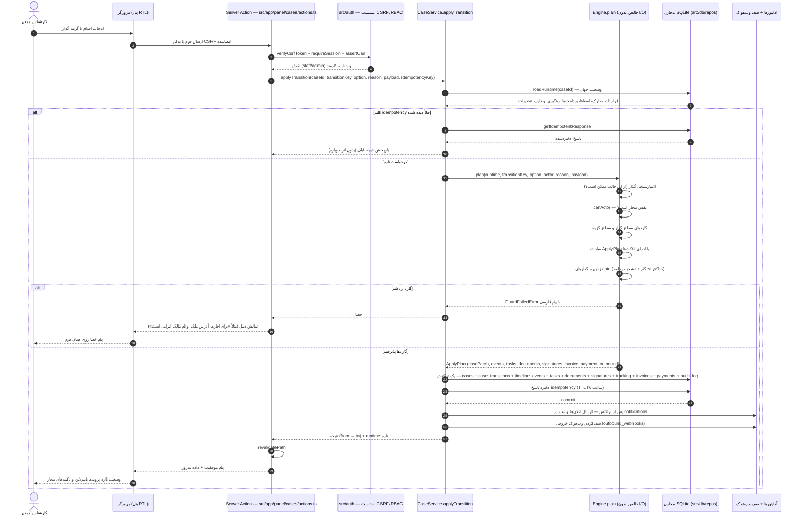

---

## 06-engine-plan

### درون موتور گردش‌کار

منطق `Engine.plan`: اعتبارسنجی، گاردها، گزینه‌ها، زنجیره گذارهای خودکار (سقف ۲۵ گام + تشخیص حلقه) و حالت پایانی.

* فایل: [`06-engine-plan.mmd`](./06-engine-plan.mmd) — نگهداری دستی

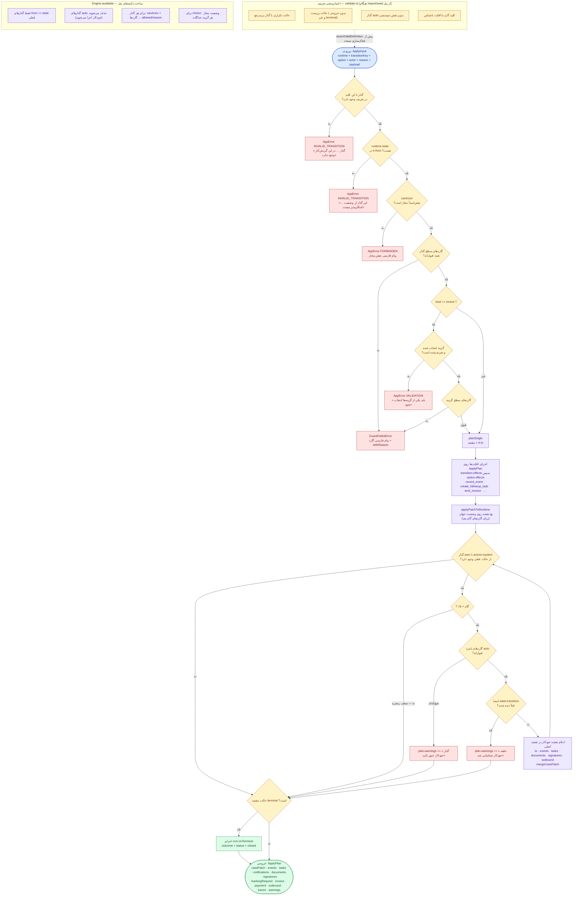

---

## 07-workflow-contract

### گردش‌کار قرارداد (contract v1)

۳۳ حالت و ۴۱ گذار: انتخاب خدمت → اطلاعات قرارداد → مالی → مدارک → حقوقی → امضا → کد رهگیری → بستن پرونده.

* فایل: [`07-workflow-contract.mmd`](./07-workflow-contract.mmd) — تولید خودکار از کد (`npm run diagrams`)

```mermaid
stateDiagram-v2
  direction TB
  state "شروع پرونده قرارداد ⟦آغاز⟧<br/>contract_start" as contract_start
  state "ثبت اطلاعات اجاره<br/>rent_info" as rent_info
  state "ثبت اطلاعات خرید و فروش<br/>sale_info" as sale_info
  state "تعیین خروجی موردنیاز ⟦تصمیم⟧<br/>output_choice" as output_choice
  state "بدون کد رهگیری<br/>no_tracking" as no_tracking
  state "با درخواست کد رهگیری<br/>with_tracking" as with_tracking
  state "تشکیل پرونده خدمت<br/>case_created" as case_created
  state "بررسی شرایط مالی مختص همین خدمت ⟦تصمیم⟧<br/>finance_check" as finance_check
  state "پرداخت مستقیم ⟦تصمیم⟧<br/>payment_direct" as payment_direct
  state "اشتراک برای این خدمت معتبر است؟ ⟦تصمیم⟧<br/>subscription_check" as subscription_check
  state "شرایط ریفرال یا معافیت تأیید شده است؟ ⟦تصمیم⟧<br/>referral_check" as referral_check
  state "ثبت خطا و پیگیری پرداخت ⟦خطا/حلقه⟧<br/>payment_error" as payment_error
  state "تأیید وضعیت مالی<br/>finance_ok" as finance_ok
  state "بررسی مدارک قرارداد ⟦تصمیم⟧<br/>documents_review" as documents_review
  state "اعلام مدارک موردنیاز ⟦خطا/حلقه⟧<br/>documents_incomplete" as documents_incomplete
  state "اعلام دلیل رد و درخواست اصلاح ⟦خطا/حلقه⟧<br/>documents_rejected" as documents_rejected
  state "صف بررسی کارشناس<br/>documents_pending_queue" as documents_pending_queue
  state "نوع قرارداد خرید و فروش است؟ ⟦تصمیم⟧<br/>sale_branch" as sale_branch
  state "بررسی حقوقی<br/>legal_review" as legal_review
  state "نتیجه بررسی حقوقی ⟦تصمیم⟧<br/>legal_result" as legal_result
  state "اصلاح بندهای قرارداد<br/>clause_edit" as clause_edit
  state "ثبت رد و دلیل آن ⟦پایانی⟧<br/>contract_rejected" as contract_rejected
  state "نیاز به ویرایش بند دارد؟ ⟦تصمیم⟧<br/>clause_edit_decision" as clause_edit_decision
  state "آماده‌سازی برای امضا<br/>signature_prep" as signature_prep
  state "ارسال و پیگیری امضای طرفین<br/>signature_collect" as signature_collect
  state "امضاهای لازم کامل و معتبرند؟ ⟦تصمیم⟧<br/>signature_check" as signature_check
  state "پیگیری امضاهای باقی‌مانده ⟦خطا/حلقه⟧<br/>signature_followup" as signature_followup
  state "کد رهگیری درخواست شده است؟ ⟦تصمیم⟧<br/>tracking_decision" as tracking_decision
  state "اتمام قرارداد با امضا، بدون کد رهگیری ⟦پایانی⟧<br/>contract_done_no_tracking" as contract_done_no_tracking
  state "ارسال درخواست کد رهگیری<br/>tracking_request" as tracking_request
  state "کد رهگیری دریافت شده؟ ⟦تصمیم⟧<br/>tracking_check" as tracking_check
  state "ثبت خطا و پیگیری رفع مشکل ⟦خطا/حلقه⟧<br/>tracking_error" as tracking_error
  state "ثبت کد رهگیری و اتمام قرارداد ⟦پایانی⟧<br/>contract_done_with_tracking" as contract_done_with_tracking

  [*] --> contract_start
  contract_rejected --> [*]
  contract_done_no_tracking --> [*]
  contract_done_with_tracking --> [*]

  contract_start --> rent_info : انتخاب نوع قرارداد ▸ اجاره ⟦انتخابی⟧
  contract_start --> sale_info : انتخاب نوع قرارداد ▸ خرید و فروش ⟦انتخابی⟧
  rent_info --> output_choice : ثبت اطلاعات اجاره
  sale_info --> output_choice : ثبت اطلاعات خرید و فروش
  output_choice --> no_tracking : تعیین خروجی موردنیاز ▸ فقط امضا ⟦انتخابی⟧
  output_choice --> with_tracking : تعیین خروجی موردنیاز ▸ امضا و کد رهگیری ⟦انتخابی⟧
  no_tracking --> case_created : تشکیل پرونده خدمت ⟦خودکار⟧
  with_tracking --> case_created : تشکیل پرونده خدمت ⟦خودکار⟧
  case_created --> finance_check : ورود به بررسی شرایط مالی ⟦خودکار⟧
  finance_check --> payment_direct : انتخاب روش تسویه ▸ پرداخت مستقیم ⟦انتخابی⟧
  finance_check --> subscription_check : انتخاب روش تسویه ▸ اشتراک ⟦انتخابی⟧
  finance_check --> referral_check : انتخاب روش تسویه ▸ ریفرال یا معافیت ⟦انتخابی⟧
  finance_check --> finance_ok : انتخاب روش تسویه ▸ بدون نیاز به پرداخت ⟦انتخابی⟧
  payment_direct --> finance_ok : پرداخت موفق ⟦خودکار⟧
  payment_error --> finance_ok : پرداخت موفق ⟦خودکار⟧
  subscription_check --> finance_ok : پرداخت موفق ⟦خودکار⟧
  referral_check --> finance_ok : پرداخت موفق ⟦خودکار⟧
  payment_direct --> payment_error : ثبت خطا و پیگیری پرداخت ⟦خودکار⟧
  subscription_check --> payment_error : ثبت خطا و پیگیری پرداخت ⟦خودکار⟧
  referral_check --> payment_error : ثبت خطا و پیگیری پرداخت ⟦خودکار⟧
  payment_error --> payment_direct : تلاش مجدد پرداخت
  payment_error --> contract_rejected : انصراف از پرداخت و بستن پرونده
  subscription_check --> finance_ok : اشتراک معتبر است ⟦خودکار⟧
  subscription_check --> payment_direct : اشتراک معتبر نیست — هدایت به پرداخت مستقیم
  referral_check --> finance_ok : ریفرال یا معافیت تأیید شد
  referral_check --> payment_direct : ریفرال یا معافیت تأیید نشد — هدایت به پرداخت مستقیم
  finance_ok --> documents_review : بررسی مدارک قرارداد ⟦خودکار⟧
  documents_review --> documents_incomplete : اعلام مدارک موردنیاز
  documents_review --> documents_rejected : اعلام دلیل رد و درخواست اصلاح
  documents_incomplete --> documents_review : بارگذاری یا اصلاح مدارک
  documents_rejected --> documents_review : بارگذاری یا اصلاح مدارک
  documents_review --> documents_pending_queue : ارسال به صف بررسی کارشناس
  documents_pending_queue --> documents_review : ثبت نتیجه بررسی مدارک توسط کارشناس
  documents_review --> sale_branch : تأیید همه مدارک
  sale_branch --> legal_review : خرید و فروش — بررسی حقوقی ⟦خودکار⟧
  sale_branch --> clause_edit_decision : اجاره — تصمیم ویرایش بند ⟦خودکار⟧
  clause_edit_decision --> legal_review : نیاز به ویرایش بند دارد ▸ بله — ارجاع به بررسی حقوقی ⟦انتخابی⟧
  clause_edit_decision --> signature_prep : نیاز به ویرایش بند دارد ▸ خیر — آماده‌سازی امضا ⟦انتخابی⟧
  legal_review --> legal_result : آماده ثبت نتیجه بررسی حقوقی ⟦خودکار⟧
  legal_result --> signature_prep : تأیید بررسی حقوقی
  legal_result --> clause_edit : نیاز به اصلاح بند
  legal_result --> contract_rejected : رد قرارداد در بررسی حقوقی
  clause_edit --> legal_review : اصلاح بندهای قرارداد
  signature_prep --> signature_collect : ارسال و پیگیری امضای طرفین
  signature_collect --> signature_check : بررسی وضعیت امضاها
  signature_followup --> signature_check : بررسی وضعیت امضاها
  signature_check --> signature_followup : پیگیری امضاهای باقی‌مانده ⟦خودکار⟧
  signature_check --> tracking_decision : همه امضاها کامل و معتبر ⟦خودکار⟧
  tracking_decision --> contract_done_no_tracking : اتمام قرارداد بدون کد رهگیری ⟦خودکار⟧
  tracking_decision --> tracking_request : ارسال درخواست کد رهگیری ⟦خودکار⟧
  tracking_request --> tracking_check : تلاش مجدد برای کد رهگیری ⟦خودکار⟧
  tracking_check --> contract_done_with_tracking : کد رهگیری دریافت شد
  tracking_check --> tracking_error : ثبت خطا و پیگیری رفع مشکل
  tracking_error --> tracking_request : تلاش مجدد برای دریافت کد رهگیری
  tracking_error --> contract_rejected : انصراف از کد رهگیری و بستن پرونده

  note right of contract_start
    منبع حقیقت: workflow-definitions/contract.v1.json
    نسخه‌ای که پرونده با آن ساخته می‌شود قفل می‌گردد
  end note
```

---

## 08-workflow-listing

### گردش‌کار آگهی (listing v1)

بررسی مالی آگهی → تکمیل اطلاعات → بررسی کارشناس → انتشار/توقف/انقضا/بستن.

* فایل: [`08-workflow-listing.mmd`](./08-workflow-listing.mmd) — تولید خودکار از کد (`npm run diagrams`)

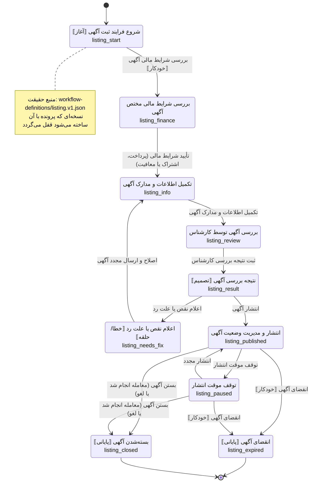

---

## 09-workflow-requirements

### گردش‌کار نیازمندی‌ها (requirements v1)

ثبت نیازمندی → سطح دسترسی → تطبیق با آگهی‌ها → برآورده‌شدن یا انقضا.

* فایل: [`09-workflow-requirements.mmd`](./09-workflow-requirements.mmd) — تولید خودکار از کد (`npm run diagrams`)

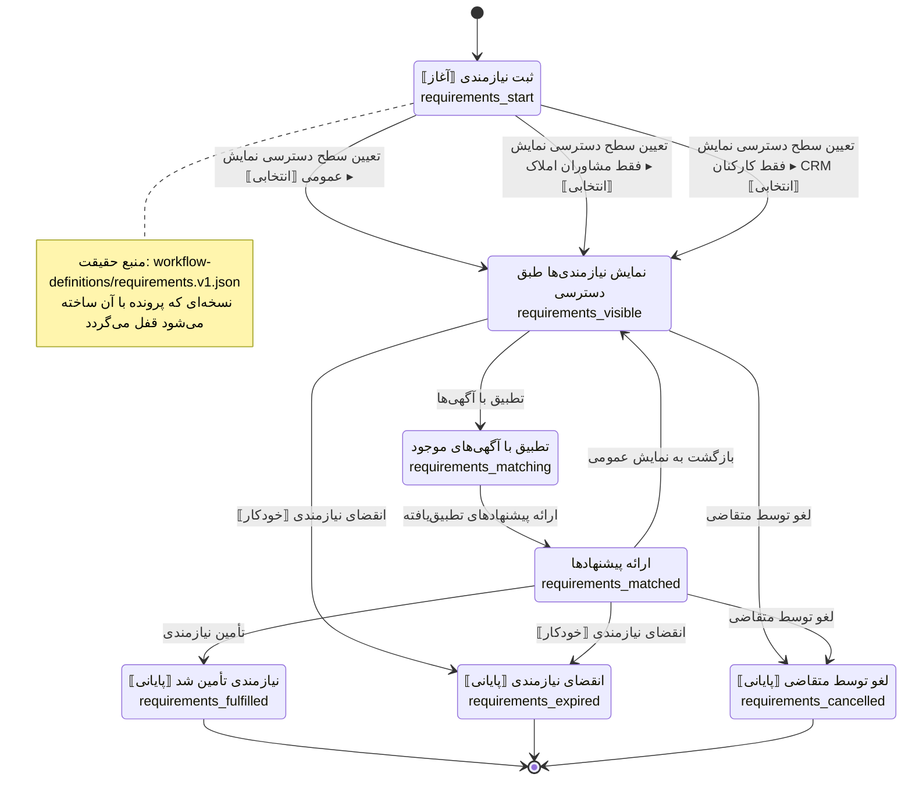

---

## 10-workflow-custom-service

### گردش‌کار سایر خدمات (custom_service v1)

قالب عمومی خدمت سفارشی: ثبت → بررسی مالی → بررسی کارشناس → بستن پرونده.

* فایل: [`10-workflow-custom-service.mmd`](./10-workflow-custom-service.mmd) — تولید خودکار از کد (`npm run diagrams`)

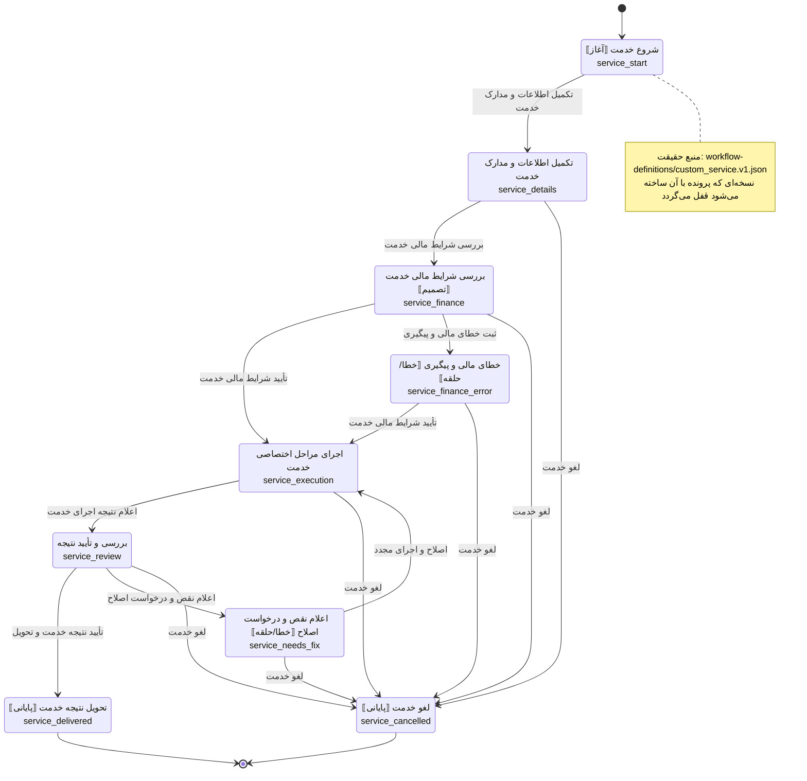

---

## 11-guards-effects-map

### نگاشت گاردها و افکت‌ها

کدام گارد/افکت در کدام گردش‌کار استفاده شده و کدام کلیدهای رجیستری هنوز مصرف‌کننده ندارند.

* فایل: [`11-guards-effects-map.mmd`](./11-guards-effects-map.mmd) — تولید خودکار از کد (`npm run diagrams`)

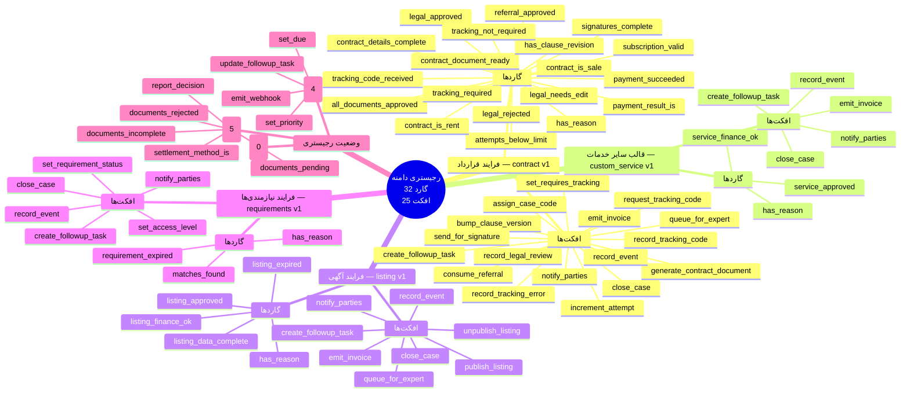

---

## 12-sync-push

### سینک Push (اینگست)

مسیر `POST /api/v1/ingest/[entity]`: احراز هویت دوگانه (کلید + HMAC)، idempotency و پردازش آیتم‌به‌آیتم.

* فایل: [`12-sync-push.mmd`](./12-sync-push.mmd) — نگهداری دستی

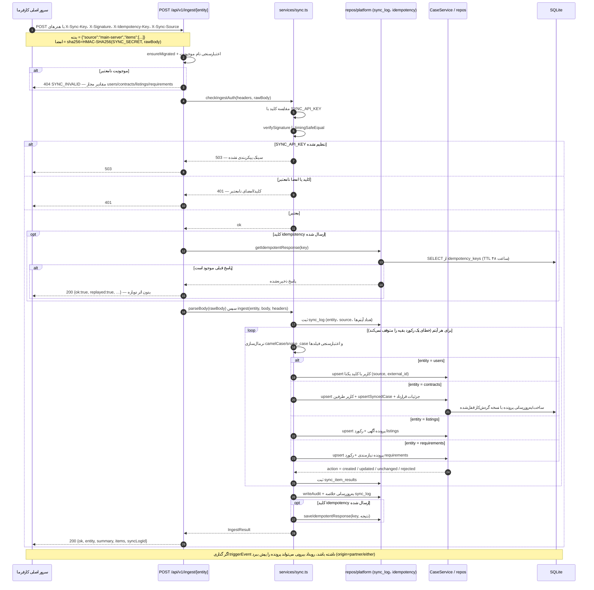

---

## 13-sync-pull-webhook

### سینک Pull و Webhook خروجی

کارهای زمان‌بندی‌شده: واکشی با کرسور از سرور اصلی و ارسال وب‌هوک با backoff نمایی (سقف ۵ تلاش).

* فایل: [`13-sync-pull-webhook.mmd`](./13-sync-pull-webhook.mmd) — نگهداری دستی

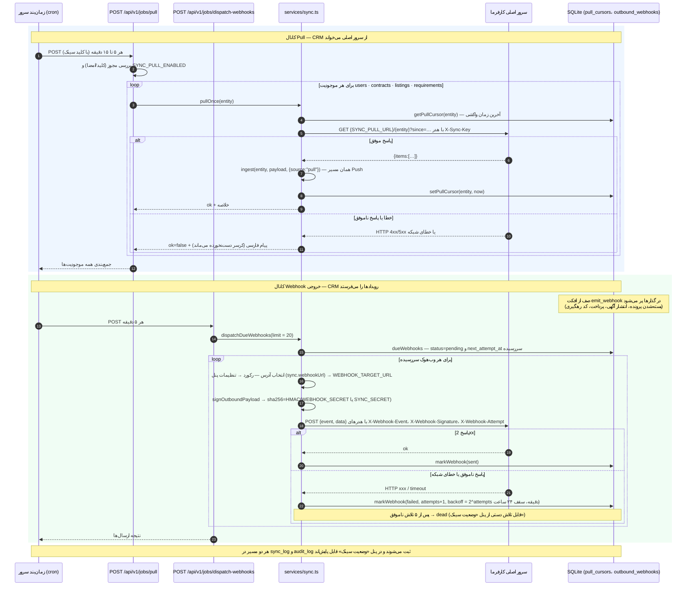

---

## 14-auth-session

### احراز هویت، نشست و RBAC

ورود (scrypt/SSO)، کوکی HttpOnly، مسیر بدون کوکی با `X-Session-Ticket`، CSRF بدون‌حالت و ماتریس دسترسی.

* فایل: [`14-auth-session.mmd`](./14-auth-session.mmd) — نگهداری دستی

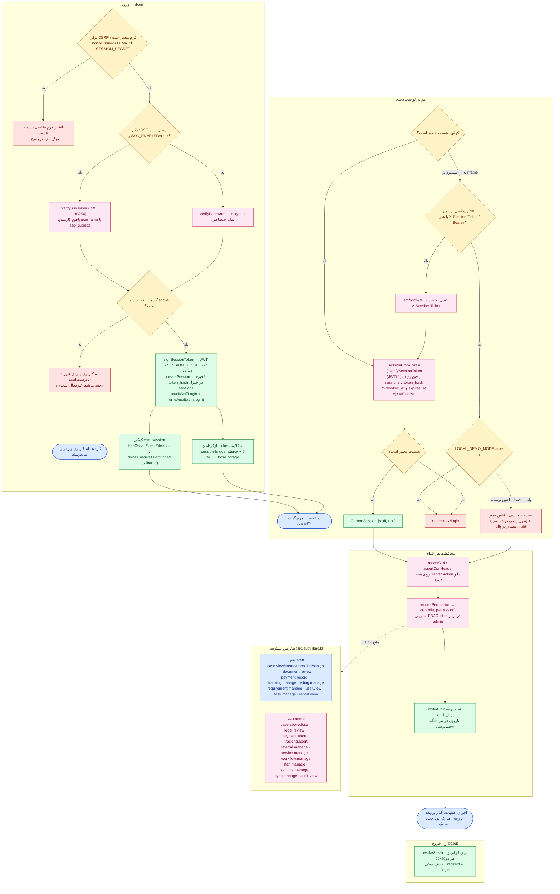

---

## 15-panel-sitemap

### نقشه پنل و API

صفحات `/panel/**` در سه گروه کارتابل/پرونده‌ها/مدیریت، Server Actionهای هر صفحه و endpoint های HTTP.

* فایل: [`15-panel-sitemap.mmd`](./15-panel-sitemap.mmd) — نگهداری دستی

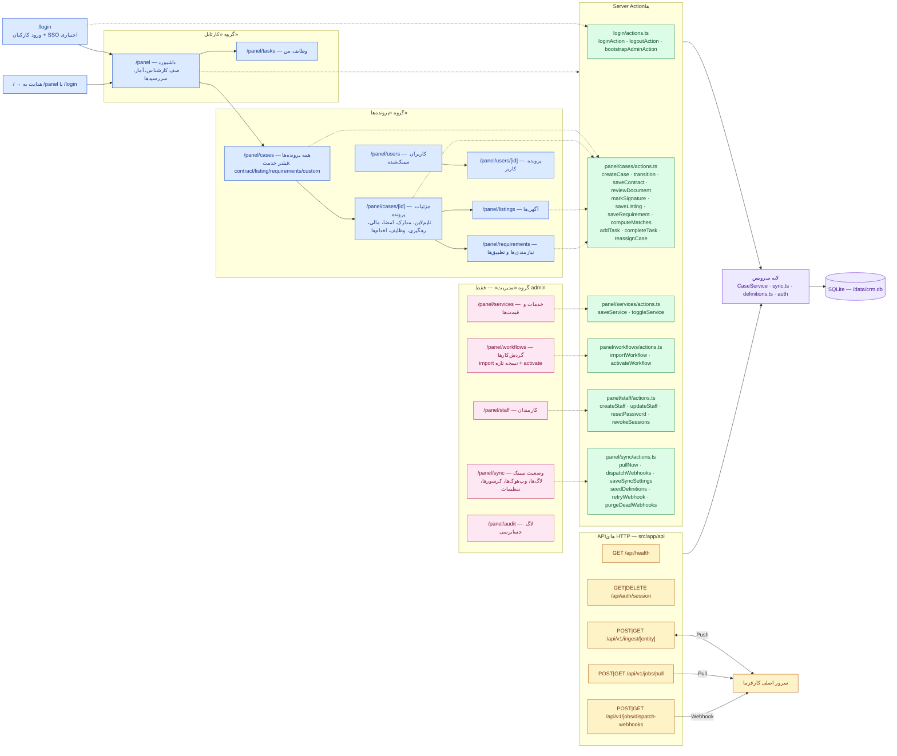

---

## 16-deployment

### استقرار با داکر

ایمیج چندمرحله‌ای، والیوم `crm-data` (SQLite)، معکوس‌پروکسی، crontab و متغیرهای محیطی حساس.

* فایل: [`16-deployment.mmd`](./16-deployment.mmd) — نگهداری دستی

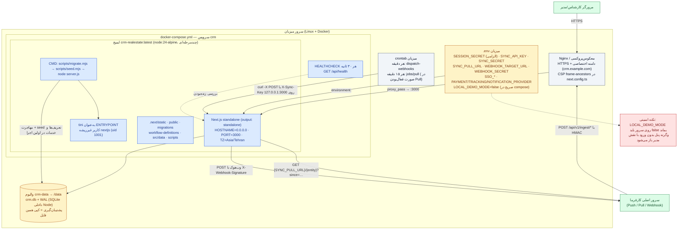

---

## نکته‌ها

* اگر دیاگرام تولیدی با کد هم‌خوان نباشد، `npm run diagrams:check` در CI شکست می‌خورد.
* برای ویرایش گردش‌کارها فقط `workflow-definitions/*.json` را تغییر دهید (یا از پنل «گردش‌کارها» نسخه تازه وارد کنید) و سپس `npm run diagrams` را اجرا کنید.
* فلوچارت تودرتو و کامل همه گردش‌کارها در `docs/superpowers/specs/2026-10-13-crm-flowchart.mmd` قرار دارد (`npm run flowchart`).
